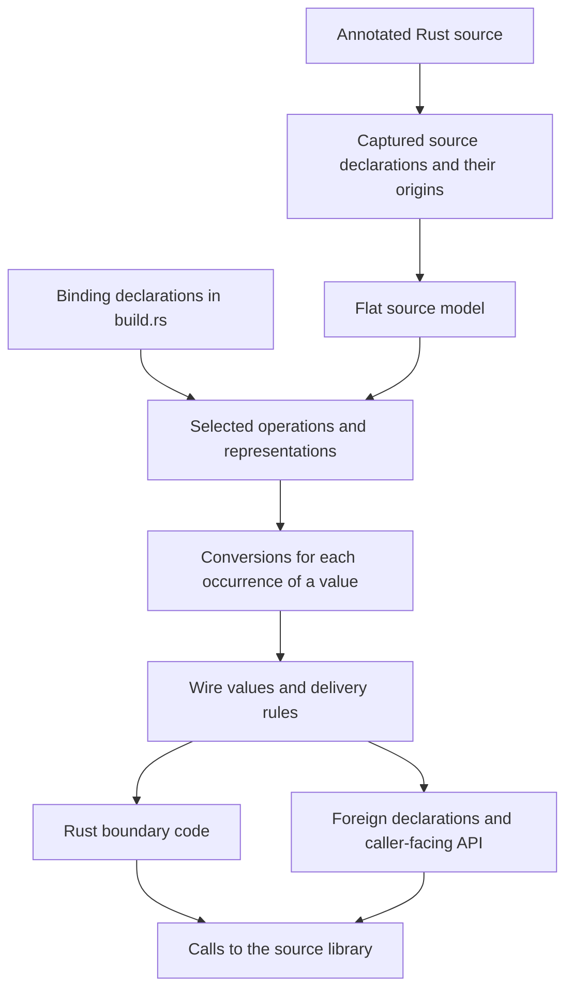

# Conceptual data flow

This document records an understanding of prebindgen for the discussion of
language-generator authoring, based on [the 0.7.0 PR](https://github.com/milyin/prebindgen/pull/778)
at `e07aa9466`. It describes the information and values that flow through a
binding. It does not propose a replacement architecture or prescribe interfaces.

The fixed boundaries for that discussion are source capture through
`#[prebindgen]`, the basic flat-source model, and the production JniGen
`build.rs` declaration API. The organization of the code between those
boundaries remains open. Examples of C and JNI representations below illustrate
current choices; those choices are not universal properties of prebindgen.

## From source and binding intent to a callable API

There are two inputs to generation. The source describes what Rust offers.
The binding author describes which parts to expose and how callers in another
language should use them.



These arrows express information dependencies, not a required sequence of
implementation phases. The Rust and foreign outputs have to describe the same
crossing: the same values, in the same order, with matching presence, choice,
ownership, and failure meanings.

The source can come from several crates. Its names identify items in one flat
namespace, while their origins identify the Rust definitions to call and the
source locations to report. Capture also carries build-configuration context:
the API seen during generation must agree with the source library compiled into
the binding. Selecting items for a binding does not erase that dependency.

## What the flat source contributes

“Flat” describes an explicit, named Rust API made from free functions, declared
types, and constants. It does not mean that every value has one field or that
every type must travel as a flat parameter list. A nested record, a collection,
or an alternative with a payload can still belong to a flat API.

The model supplies these facts:

| Source fact | Information available to the binding |
|---|---|
| Free function | Ordered arguments, result, and the source operation to call |
| Record | Fields that belong together as one value |
| Fieldless enum | Named values and their discriminants |
| Data-carrying enum | One chosen alternative and that alternative's fields |
| Opaque named type | A Rust type whose contents are outside the model |
| Constant | A named source value and its type |
| Type composition | Optionality, sequences, fixed extents, success/error alternatives, callbacks, and wrappers |
| Access to a value | Ownership, shared borrowing, or exclusive borrowing |

An opaque source type does not by itself require a foreign handle. For example,
`Duration` can remain opaque in the source model and cross through a declared
numeric representation. Conversely, knowing a record's fields does not itself
select a foreign class or memory layout.

The flat language is a bounded subset of Rust. It supplies explicit signatures
and named relationships rather than asking a generator to discover arbitrary
methods, traits, or generic APIs. Its callback form describes callable input
with known argument types. Source acceptance and support for a particular
crossing are separate questions: an understood source type may still have no
supported representation in a chosen language, direction, or position.

## What the binding declarations contribute

The JniGen declaration vocabulary describes several related decisions.

| Binding intent | Meaning for the flow |
|---|---|
| Packages, classes, functions, methods, constructors, constants | Select and arrange the foreign API |
| Handle, data, enum, or sealed class | Choose how a declared type appears to Kotlin |
| `convert!` | Route a source type through another Rust representation type |
| `expand_param!` | Supply a value through a selected constructor or an existing handle |
| `expand_return!` | Deliver selected observations of a value, possibly including the value itself |
| Per-function and per-field expansion declarations | Replace a default decision at a particular occurrence |
| Names and naming policies | Give the selected surface its foreign names and placement |
| Explicit exclusions | Record which source items intentionally have no exported surface |

A function can participate as a constructor, getter, or conversion without
also being exported as a callable foreign function. A binding-local helper with
a stated signature can supply such a step. A named foreign constant can likewise
come from a source constant or a binding-declared computation.

Type declarations and crossing declarations answer different questions. A
Kotlin handle class can exist even when the usual input for that type is a
string and its usual output is a group of fields. Placing a source function as a
method makes one argument the receiver; placing it as a factory presents a
construction operation. Neither placement changes what the Rust function owns
or borrows.

## A value has several representations

A **source value** is the Rust value used by the flat API. A **representation
value** is another Rust value selected by a conversion declaration. A **wire
value** occupies a slot at the language boundary. The **foreign value** is what
the caller sees. One source value may require no wire values, one, or several.

```text
Into Rust:
foreign arguments → wire values → representation values, if any
                  → constructed or decoded source arguments → source call

Out of Rust:
source result → selected observations or representation values, if any
              → wire values → foreign value or caller-supplied delivery
```

For a JNI value crossing, this involves four related transformations: Kotlin
to wires, wires to Rust, Rust to wires, and wires to Kotlin. Input and output
need not use the same shape. A declaration may support only one direction.

`convert!` introduces a semantic step within that flow. With a duration
represented in milliseconds, input decodes the number and constructs a
duration; output obtains the number from the duration and encodes it. The
representation type itself still needs a crossing. Conversion can fail, and a
declared valid domain constrains representation values in either direction.
The numeric carrier alone does not express those constraints.

The same carrier can also mean different things: an integer can be a quantity,
an enum value, or a handle. Its meaning comes from the source type and the
binding declaration, not just its machine type.

## Construction and observation are different flows

An input expansion is a choice. For `KeyExpr`, the production declaration
offers construction from a string or passage of an existing handle:

```text
string → decode → KeyExpr constructor ─┐
                                      ├→ one KeyExpr argument → source call
existing handle → take or borrow ──────┘
```

Only the selected route supplies the argument. A constructor can itself need
several converted arguments and can fail. The receiving source parameter still
determines whether the resulting value is consumed or borrowed. Typed Kotlin
overloads expose these alternatives through `split_on_param`; they describe
different entrances to the same source operation.

An output expansion is a collection of observations delivered together:

```text
                         ┌→ getter → field value → its crossing ─┐
source value ────────────┼→ getter → field value → its crossing ─┼→ delivery
                         └→ identity → handle crossing ──────────┘
```

Getters can return values, borrows, optional values, or collections. Each
observation has its own conversion and ownership consequences. A returned
record can supply the fields as a group through `fields!`, so the field list
comes from the source value form: a record exposing the value's contents.
The borrowing and consuming value-form
declarations differ in whether they observe the original or take it apart.
Per-field declarations can change a nested observation or omit it from delivery.

Including identity means handing over the value itself as a handle in addition
to the other observations. All observations that need the value must remain
valid until they are complete. Taking the value away cannot invalidate a later
borrow of it.

These output fields can feed a caller-supplied builder, a collection fold
(combining successive elements into an accumulator), a callback, or an error
handler. The destination need not be a generated class.
For example, the production `Sample` output uses its consuming value form,
while `Query` delivers observations together with a handle that permits later
reply operations. The production `Error` delivers its message without needing
a Kotlin error-handle class.

Defaults are contextual. Explicit expansions replace the applicable default;
identity-only declarations request the whole value. In the examined 0.7.0
behavior, constructors keep their own-class result whole by default, and
fallible function results and expansion accessors do not automatically receive
the general return expansion. Callback arguments and error deliveries have
their own output contexts. Thus a type name alone is insufficient to determine
a crossing.

## Composition preserves relationships

Conversion of a composite value depends on its parts, but the relationships
between those parts also carry information.

| Relationship | Meaning that must survive the crossing |
|---|---|
| Record | All fields describe the same value |
| Optional value | Absence is distinct from every present value |
| Alternative | Exactly one alternative is active; only its payload is meaningful |
| Sequence | Element order, count, and correspondence between each element's fields |
| Fixed array | The required number of elements |
| Conversion through another type | The declared semantic conversion and its valid domain |
| Borrow or ownership wrapper | How the value can be accessed and how long that access remains valid |

For `Option<Vec<Record>>`, absence, a present empty sequence, and a present
nonempty sequence are different states. For `Option<Choice>`, absence is
different from a present fieldless alternative. Placeholder values in inactive
payload slots do not become live values and must not trigger their conversions.

Current JNI crossings can represent a record through its fields and a sequence
through corresponding collections of those fields. C can carry an aggregate
in a boundary struct or lend a sequence through a pointer and count. These
representations preserve the same source relationships through different wire
arrangements. Optionality may use a separate presence value or an available
absence representation; its semantic meaning stays the same.

## Direction, delivery, and lifetime belong to each occurrence

“Input” and “output” are relative to Rust. Passing a callback into Rust creates
an input callable; invoking it later sends its arguments out of Rust:

```text
foreign callback → callable supplied to Rust → retained by source code
                                             ↓ later invocation
foreign callback arguments ← wires ← Rust callback arguments
```

The callback's lifetime can exceed the registration call. The lifetime of a
value delivered during an invocation is a separate matter. In the current JNI
binding, delivered handle values can be subject to callback-scope cleanup;
retaining an object reference is not itself an ownership transfer. C callback
arguments can likewise be lent for the duration of the call.

A borrowed handle input grants access for the source call. A consumed handle
input transfers its owned value and ceases to be a usable foreign owner.
An owned handle or allocated-resource output establishes a foreign-side release
obligation. Current JNI
borrowed opaque outputs obtain a fresh owned value by cloning; that is a
binding choice, not a claim that Rust borrows inherently cross as ownership.

Lifetime and cleanup therefore accompany the data flow, including nested
handles and failures partway through conversion. Checks, synchronization, and
release behavior support that contract. The carrier's type alone cannot say
when access ends or who releases a resource.

Results also require a delivery decision. A native return slot, an output
parameter, and a call into a receiver can all carry a logical result. JNI uses
receiver calls for values that need several wire values; an expanded result
can instead feed a builder or fold. A Rust output parameter is another output
flow even though it appears in the source function's parameter list.

## Success and failure travel through the binding

```text
foreign input → input conversion → source operation → output conversion
                    │                    │                   │
                    │                    └→ source error     │
                    └→ binding failure                       └→ binding failure
```

A malformed foreign value or a failed representation conversion is a binding
failure. A source function returning `Err` is an outcome of the requested
operation. These have different origins even where a binding routes them
through the same foreign mechanism.

JniGen can deliver a declared source error through its output expansion to a
typed error handler, while conversion failures use the binding-error channel.
Errors without that declared delivery can use the binding-error channel too.
C's error reporting uses its chosen result and error-output convention.
Failure delivery is part of the call contract; it is not determined merely by
whether the successful result is a handle, scalar, or record.

## The generator author's view of the whole flow

For any selected operation, understanding the crossing means following its
source values through construction or observation, nested conversions, wire
transport, foreign presentation, and eventual release. The relevant information
includes the occurrence's direction, access, surrounding structure, applicable
declarations, and success or failure destination.

The C and JNI generators encounter these same questions even when their answers
are different. This is the common subject of the API discussion. This document
leaves open how that information is represented, which components own each
decision, and which operations generator authors share.
