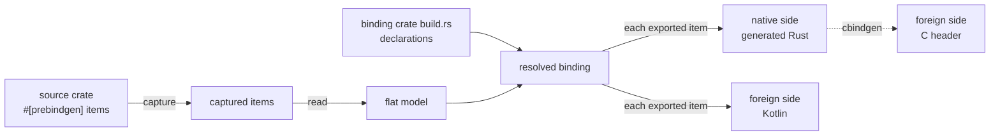
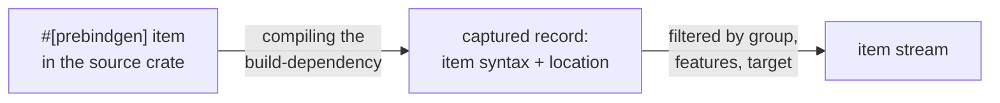
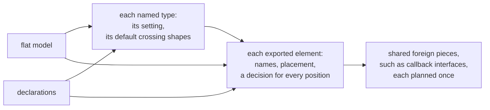
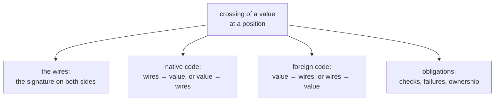

# How a binding is derived: the data flow

prebindgen generates bindings of a Rust library for other languages. The
library is the **source crate**, and it marks its exported items
`#[prebindgen]`. For each target language, an **adapter** (`prebindgen-c`,
`prebindgen-jni`) generates the binding from those items.

This document describes the information prebindgen works with: where each
piece comes from, and how the pieces combine into a binding. It describes
the flow rather than the code. It names no internal types or functions,
because those are being redesigned.

Three parts are fixed:

* the `#[prebindgen]` capture in the source crate;
* the **flat model**: the subset of Rust a source crate may write, read
  into one namespace;
* the build-script vocabulary of the JNI (Java Native Interface) adapter:
  `ptr_class!`, `expand_param!`, `expand_return!` and the rest.
  zenoh-flat-jni, the JNI binding of the Zenoh library, uses it in
  production.

Everything between the flat model and the generated files is open to
change. The examples below use the JNI vocabulary, and cite the C adapter's
vocabulary where it differs.

## 1. The whole flow

Besides the source crate, a **binding crate** takes part. It targets one
foreign language: its `build.rs` runs the adapter to generate the binding,
and its library compiles the generated code. The binding has two sides:

* the **native side**: the generated Rust, compiled into the binding crate,
  which calls the source crate;
* the **foreign side**: what the target language sees, which is a C header
  or Kotlin sources.

A value **crosses** when it passes from one side to the other.

Only two inputs carry information:

* the **flat model** says what exists;
* the **declarations** in the binding crate's `build.rs` say what to export
  and how.

Everything after these two is derived from them. The two inputs meet when
the binding is resolved. That is where every error in either input is
found, before anything is written.

For JNI, the adapter writes both sides itself. For C, the adapter writes
only the native side. cbindgen, a tool that writes a C header from Rust
`extern "C"` declarations, derives the header from it. So in the C
binding, the foreign side is whatever the native side's signatures say.

## 2. Capture

The capture records each marked item's syntax and location: its crate,
file and line. It does this when the source crate is compiled as a
**build-dependency** of the binding crate. The generated code later calls
the **regular dependency** instance of the same crate. That instance may be
compiled with other features or for another target, so the two need not
match.

Three kinds of information ride along with the items:

* **groups**: an item may be marked into a named group
  (`#[prebindgen("group")]`), and a build script may read selected groups
  only;
* **feature guards**: an item that asserts, at compile time of the binding
  crate, that the source crate was compiled with the features the capture
  saw;
* **target filtering**: `cfg` conditions resolved for the binding's target,
  which matters when cross-compiling.

What leaves this stage is a stream of items, each paired with its
location. Nothing has been interpreted yet.

## 3. The flat model

The flat model reads the item stream into **elements**: the named things a
source crate declares. All elements live in one namespace, even when the
stream comes from several source crates. A name is an address: it is
unique, and every type reference must resolve to an element of that name.

### Elements

| Element | What it is |
|---|---|
| function | parameters in order and a return type; no receiver and no generics |
| struct | a product: named or positional fields, each with a type |
| sum | an enum with payloads; alternatives are identified by their **order**, each with fields |
| enum | a fieldless enum; values are identified by the **integer Rust assigns** |
| extern | a named type whose contents the model does not see: `pub type X = path::Y;` or a tuple struct |
| constant | a named value with a type and an initializer |
| guard | an anonymous `const _`, re-emitted verbatim (the feature guards) |
| unsupported | a marked item the language cannot express, kept with its diagnosis |

An extern is not necessarily a **handle**, a value the foreign side holds
only by reference. The model only says that it does not see the
contents. What the type becomes at the boundary is decided by the
declarations.

### Type forms

Every type written in a parameter, return, field or alternative is one of a
closed set of forms. The form is what the source wrote, so two spellings
are two forms even when every destination would treat them alike:

| Form | Meaning at the boundary |
|---|---|
| scalar (`bool`, integers, floats) | a primitive |
| `String`, `str` | text; owned or unsized |
| `Vec<T>`, `[T]` | a run of `T`; owned or unsized |
| `[T; N]` | a run of fixed length `N` |
| `Option<T>` | a `T` or nothing |
| `Result<T, E>` | a `T`, or an error `E`; only as a function's return |
| `&T`, `&mut T` | a `T` that is borrowed, shared or exclusive |
| `&mut MaybeUninit<T>` | a slot the callee fills, provided by the caller |
| `Box<T>`, `Cow<T>` | a `T`; the wrapper is invisible at the boundary but must be put back on the native side |
| `impl Fn(A, B, …)` | a callback the foreign side provides; it returns nothing |
| `()` | nothing |
| a name | a struct, sum, enum or extern of the model |

Each type keeps two things: its form, which decisions are made from, and
its original spelling, which the generated Rust re-emits.

### What the model does not contain

The flat model has no methods, no receivers, no traits, no generics, no
`async`, no raw pointers, and no callbacks that return a value. An
object-like API is therefore written as free functions over handles:
`keyexpr_as_str(&KeyExpr)`, `session_put(&Session, …)`. The object
structure of the foreign API (classes, methods, constructors) is not in the
source. The declarations add it.

### Refusal

Reading never fails on a single item. An item the language cannot express
becomes *unsupported* and carries its diagnosis. Only a rule over the whole
stream fails the read, such as a duplicate name. A binding is never built
from a model that contains unsupported items: every such item is reported
at once, before any declaration is examined.

## 4. Declarations

The binding author's `build.rs` is the second input. Its declarations carry
five kinds of information:

| Kind | What it says | JNI | C |
|---|---|---|---|
| selection | which elements are exported, and which are left out deliberately | `package!().fun(..)`, class members, `constant!`, `.ignore(..)` | `.function(..)`, `.ignore_function(..)` |
| type setting | how a named type is represented, once per type | `ptr_class!`, `data_class!`, `enum_class!`, `sealed_class!`, `convert!` | `.opaque_ptr`, `.data_struct`, `.repr_c_struct`, `.enum_type`, `.tagged_union`, `.opaque_error`, `.convert` |
| crossing shape | how a value of a type is supplied as input or handed back as output; a default per type, replaceable for one parameter, result or field | `expand_param!`, `expand_return!`, `fields!`, per-function `.expand_param` / `.expand_return` | — |
| foreign organization | how the foreign surface is arranged and named | packages, `.method`, `.constructor`, `.name`, name hooks, `.interface`, `.split_on_param` | name manglers, `.base_name`, `.callback` |
| runtime policy | behaviour of the generated code that belongs to no single type | `.gc_managed()`, handle locks, native-library init | `.panic()`, `.free_memory_function` (the exported function C calls to release memory the binding hands out) |

Three rules hold for all of them:

* **Declarations are opt-in.** An element that is not selected generates
  nothing. A source item that is neither selected nor ignored produces a
  warning, so newly added source items stay visible.
* **Every declaration names source items** by their flat names, and every
  name is checked against the model.
* **Built-in forms need no setting. Named types do.** Scalars, text,
  sequences, options and the like cross without any declaration. A named
  type crosses only after the binding author has said how. Usually that is
  a setting. A type that is only ever handed back may instead have just an
  output crossing shape (§6.4): zenoh-flat-jni declares no class for
  zenoh's `Error`, and hands back only its message.

### Type settings

A setting answers one question: *what about this type crosses?*

| Setting | What crosses | Fits |
|---|---|---|
| handle (`ptr_class!`, `.opaque_ptr`) | nothing of the value; the foreign side holds a reference to a value that stays native | any named type |
| data (`data_class!`, `.data_struct`) | each field, crossing as its own type does | a struct |
| enum (`enum_class!`, `.enum_type`) | the integer value; the foreign side re-states the values | an enum |
| sum (`sealed_class!`, `.tagged_union`) | which alternative, plus that alternative's fields | a sum |
| conversion (`convert!`) | another source type, the **representation**, which crosses in its place through declared functions, one for input and one for output | any named type |
| memory image (`.repr_c_struct`, C only) | the bytes, reinterpreted in place | a `#[repr(C)]` struct |
| error message (`.opaque_error`, C only) | text produced by a declared function | any named type |

A conversion may fail in either direction. It may also declare a **valid
domain** for its representation. A value outside the domain is an error,
and the values outside the domain are free to mark absence (see §6.2).

### Foreign organization

Since the source has no methods, the declarations rebuild the object
structure from free functions:

* `.method(fun!(f))` makes `f` a method of the class, and `f`'s first
  parameter becomes the receiver;
* `.constructor(fun!(f))` makes `f` a factory of the class;
* `package!("x")` groups classes, functions and constants into one foreign
  namespace;
* names come from hooks applied to the source names, unless `.name(..)`
  gives one explicitly.

In JNI, a constant may come from a source `const`, from a nullary function,
or from an expression evaluated in the binding crate. Each becomes a
nullary getter on the native side and a value on the foreign side. The C
adapter exports no constants.

## 5. Resolution

Resolution combines the two inputs into decisions, most of them about
positions.

A **position** is a place in an exported element where a value appears.
The top-level positions are each parameter, the receiver, the success
result and the error. Nested positions are a field, a sum alternative's
payload, an option's content, a sequence element and a callback argument.

A position has a **direction**:

* **in** means foreign to native: parameters and everything nested in them;
* **out** means native to foreign: results, errors, and the arguments of a
  callback, which the native side calls.

A callback parameter is both. The callback object goes in, and its
arguments come out on every call.

The decision at a position starts from the type's setting and default
crossing shape. A declaration for that position (`.expand_param("p", ..)`,
`.expand_return(..)`, `fields!(..).field("f", ..)`) replaces the default.
In JNI, a result type's default crossing shape does not apply to three
kinds of function: a constructor returning its own class, a function
returning `Result`, and a getter that an `expand_return!` declaration uses
as a field.

Resolution is where every inconsistency surfaces: a name the model does not
have, a setting that does not fit the element kind, a form a position
cannot carry, or a conversion whose functions do not match. After
resolution, nothing remains to decide. Writing only renders the decisions.

## 6. Crossing

A **wire** is one value of a type both sides understand natively: a C
scalar or pointer, or a JNI primitive, string, array or object reference. A
wire sits in the signature of a generated function or struct, or of a call
the native side makes into the foreign side.

A **crossing** is the full description of how a value at one position
becomes wires and back. It is derived by recursion over the value's type,
one layer at a time. Each layer is decided by three facts:

1. the layer's **form**, from the flat model;
2. the **setting** of the type, if the layer is a named type;
3. the **position and direction**, which say what the boundary can carry
   there.

From that one recursion, four things follow, and they must agree:

In JNI, the adapter writes the foreign code: Kotlin that takes objects
apart into wires and puts them back together. The native code never reads a
foreign object's fields. In C, the foreign code is the C user's own code
working with the generated declarations, so the crossing's foreign half is
only the types in the header.

### 6.1 Layer by layer

| Layer | C | JNI |
|---|---|---|
| scalar | one wire of the same type; a `bool` coming in is validated | one JNI primitive; an unsigned type maps to a wider or an unsigned Kotlin type |
| text | NUL-terminated `char *`: read from the caller's buffer on the way in, handed out as memory the caller frees | a JVM string |
| run of `T` | pointer plus length; a returned run is memory the caller frees | a count plus one array per wire of `T` (columns); bytes become a byte array |
| fixed run `[T; N]` | not crossed | a primitive array, length checked on the way in |
| `Option<T>` | a null pointer for a handle; a returned optional run adds a success flag | a presence flag beside `T`'s wires, or a niche (§6.2) |
| `&T`, `&mut T` | a pointer the caller keeps, for a handle or a memory image; otherwise the value, decoded and lent | a handle, borrowed; otherwise the value, decoded and lent |
| `Box`, `Cow` | the inner value; the wrapper is rebuilt natively | the same |
| `&mut MaybeUninit<T>` | a pointer to caller storage the callee fills | not crossed |
| callback | a struct of context, call function and release function | a generated callback interface; each argument is delivered (§6.3) |
| `Result<T, E>` | a success value or out-parameter, plus an error slot | the success value, plus an error route (§7) |
| handle | one pointer | one integer holding the pointer |
| data | a **mirror**: a C-compatible struct with one field per source field, converted field by field | the concatenation of the fields' wires |
| enum | the integer, validated in | the integer, validated in |
| sum | a tagged union mirror | a tag plus every alternative's wires, the unused ones empty |
| conversion | the representation's crossing | the representation's crossing |

The two directions need not be symmetric. A conversion names its input
and output functions separately, and either may be absent. C validates a
`bool` coming in but trusts one going out. In JNI the crossing shapes are
per direction (§6.4).

What a position can carry also differs. In C, a struct field is a single
wire, a parameter may be a pointer to caller-kept memory, and only a result
may hand over memory the caller frees. So the same type may cross in one
position and be refused in another.

### 6.2 Absence

An optional value needs a way to say *nothing*. There are two:

* a **presence wire**: a flag beside the inner wires;
* a **niche**: a wire value the inner value never takes. This can be a null
  pointer or a null object reference, or a value outside a conversion's
  declared domain. For example, `Option<Duration>` crosses as one primitive
  integer, with `u64::MAX` meaning `None`.

The niche, when one exists, is read off the inner crossing. Absence then
costs no extra wire.

### 6.3 Delivery

A native function returns one value, but an output may have several wires.
**Delivery** is how a multi-wire output reaches the foreign side:

| Output | C | JNI |
|---|---|---|
| one wire | the return value | the return value |
| several wires | a mirror by value, or out-parameters | one **upcall** (a call from native code into foreign code) to a generated assembler that builds the object |
| an output expansion (§6.4) | — | a call into a **builder** the caller supplies, with the fields as arguments; for a sequence, a **folder** called once per element on an accumulator |
| a callback's arguments | the callback's parameters, lent for the call | the callback's parameters; each argument is itself delivered |
| an error with an output expansion | — | the arguments of a typed error handler |

Each shared foreign piece is planned once and written once: a callback
interface, an assembler, a builder, a folder or an error handler.

### 6.4 Crossing shapes (JNI)

The settings say how a type is *represented*. The crossing shapes say how a
value is *supplied* or *handed back*, and the value's representation does
not have to cross at all. There are two crossing shapes: the **input
expansion**, declared by `expand_param!`, and the **output expansion**,
declared by `expand_return!`.

**Input: `expand_param!(T)`** lists alternative ways the foreign caller may
supply a `T`:

* `.variant(fun!(ctor))`: pass `ctor`'s arguments, and the native side
  calls `ctor` to build the value inside the same call;
* `.variant_self()`: pass an existing handle.

With more than one alternative, the caller passes a **selector**: an
integer naming the alternative, beside every alternative's arguments, the
unused ones empty. For an optional parameter, a selector of `-1` means
`None`. With a single constructor, no selector is passed. On top of this
form, `.split_on_param` generates typed overloads, one per alternative.

**Output: `expand_return!(T)`** lists the parts a `T` is handed back as,
all of them in one crossing:

* `.field(fun!(getter))`: the result of a getter on the value;
* `.field_self()`: the value itself, as a handle;
* `.fields(fields!(f))` / `.fields_self_into(fields!(f))`: every field of
  the struct `f` returns, reading the value or consuming it.

Each part is delivered by its own type's crossing. A part whose type has an
output expansion of its own is spliced in recursively. A part may also be
dropped: an override with no parts means the field does not cross. Getters
read the value, so the part that consumes it goes last.

Both shapes are declared per type and apply at every position of that
type, unless a position declares its own. This is what lets one
declaration shape a whole API. The type-level default for `KeyExpr` (built
from a string, or passed as a handle) applies to every key-expression
parameter in zenoh, and individual functions override it.

## 7. Ownership and failure

Every crossing carries obligations besides moving bits.

### Ownership

Who owns the value after it crosses depends on the source's access at the
position (owned, `&`, `&mut`) and on the setting:

| Source writes | Handle | Value (text, run, data) |
|---|---|---|
| owned parameter | **consumed**: the foreign reference becomes invalid | decoded into a fresh native value |
| borrowed parameter | **lent** for the call | decoded into a temporary and lent |
| owned result | a new foreign reference the foreign side must release | handed over: C memory the caller frees, or a JVM object |
| borrowed result | cloned into a new owned reference | copied |
| callback argument | lent for the duration of the call | lent |

The foreign side releases a handle explicitly: C calls a generated
destructor, and Kotlin calls `close()`. A `.gc_managed()` class adds a
garbage-collector backstop. In Kotlin, a call checks that every handle it
touches is still open. It then locks all of them in address order, so that
concurrent calls cannot deadlock, and marks consumed handles as closed. In
C, the generated function refuses two parameters that alias one resource
when either one consumes it or borrows it exclusively.

### Failure

Failures come from three sources:

1. **invalid input** from the foreign side: a null pointer, invalid UTF-8,
   an unknown enum value or tag, a wrong array length, a value outside a
   declared domain, or a closed handle;
2. **a fallible conversion** that rejects a value;
3. **the source function** returning `Err`.

They take one of two routes:

| Route | C | JNI |
|---|---|---|
| binding error: sources 1 and 2, and 3 when `E` has no output expansion | the message in the `char **e` slot, with a failure return value; with no slot, the call aborts (`.panic()`) | the message to the binding-error handler, a parameter every generated Kotlin function takes last |
| domain error: source 3 when `E` has an output expansion | — (C has only the message route, through `.opaque_error`) | `E` delivered to a typed error handler |

A call runs in a fixed order: decode every input, which may fail; call the
source; encode the outputs, which may also fail; deliver.

## 8. The same in both adapters, and what differs

These parts of the flow are the same for C and JNI:

* the two inputs, and resolution before any output;
* a setting per named type;
* positions and directions;
* the recursion over type layers, from which the wires, the native code
  and the foreign code all follow;
* absence by presence wire or niche;
* ownership derived from access and setting;
* the three failure sources.

These parts differ:

* **the wire vocabulary**: C scalars and pointers; JNI primitives, strings,
  arrays and object references;
* **who writes the foreign side**: cbindgen derives the C header from the
  native signatures, while the JNI adapter writes the Kotlin itself;
* **delivery**: C uses out-parameters and mirrors; JNI uses upcalls,
  builders, folders and handlers;
* **crossing shapes, selectors and per-position overrides**, which only
  the JNI vocabulary has;
* **the object structure rebuilt from free functions** (classes, methods,
  constructors), which only JNI declares.
